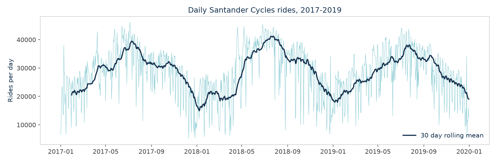
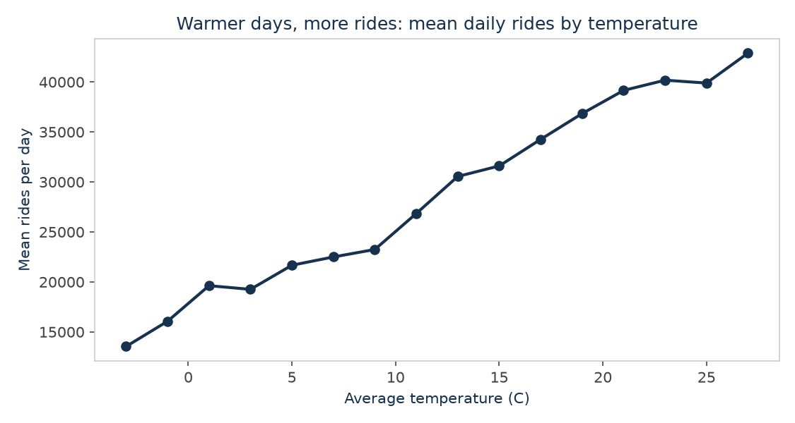
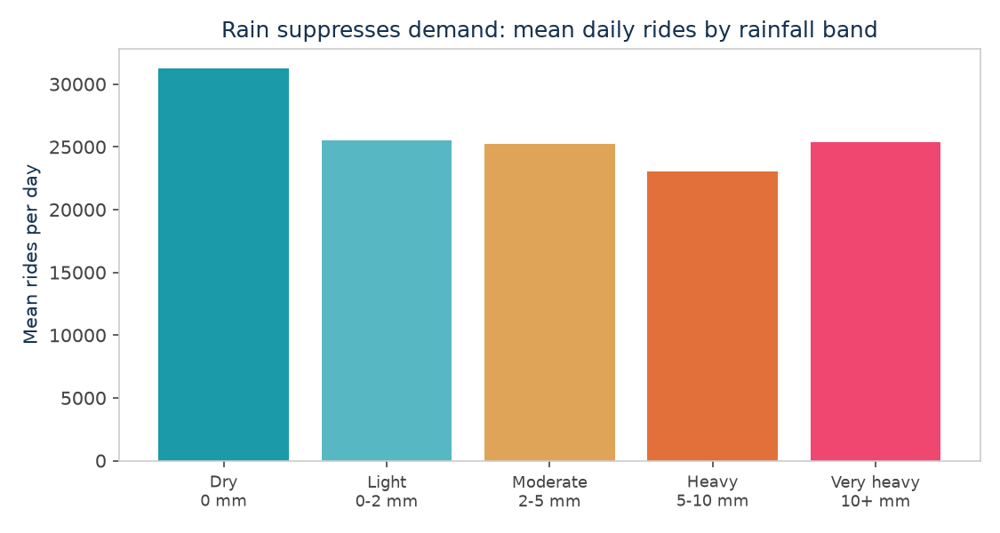
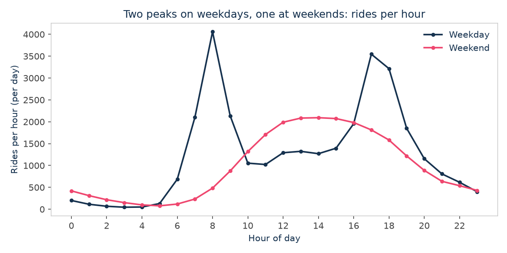
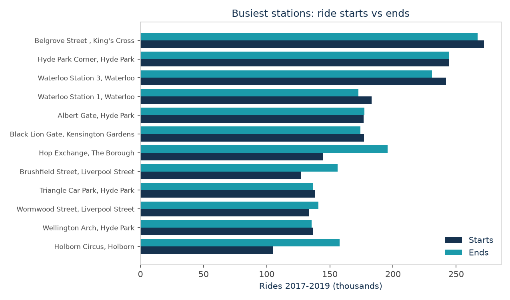
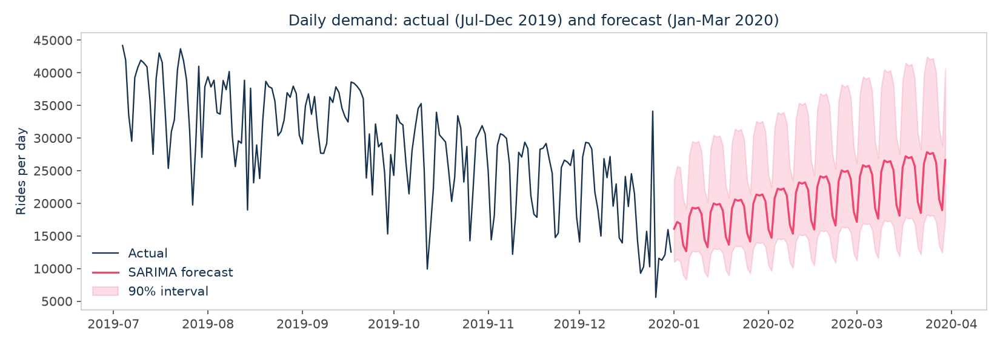

# London Bikes × Weather - Demand Forecasting with BigQuery

How much does the weather move a city bike-share scheme? This project joins two
BigQuery public datasets - `bigquery-public-data.london_bicycles` (Santander
Cycles hire data) and `bigquery-public-data.noaa_gsod` (NOAA weather) — to
quantify the weather's effect on daily demand, map station flow imbalance, and
forecast demand with BigQuery ML (ARIMA_PLUS) plus a weather regression
(LINEAR_REG).

**Headline numbers (2017–2019, computed locally from the official sources -
see "How the numbers were produced" below):**

- **30,957,132 rides** analysed over **1,088 days** across **836 stations**
- Average **28,453 rides/day**; busiest day 5 Jul 2017 (46,157 rides),
  quietest 10 Dec 2017 (5,081 rides, a snow day)
- Demand roughly **doubles from cold to warm days**: 19,777 rides/day below
  5 °C vs 39,590 rides/day at 20 °C and above (**+101%**)
- **Heavy rain (5+ mm) cuts demand by 23.7%** vs dry days
- Regression reading: **+1 °C ≈ +970 rides/day**, **+1 mm of rain ≈ −254
  rides/day**, **+1 km/h of wind ≈ −213 rides/day**
- Weekday commuting is unmistakable: **55.4%** of weekday rides fall inside
  the 07:00–09:59 and 17:00–19:59 commute windows (26.6% at weekends);
  median trip 13 minutes on weekdays vs 16 minutes at weekends



## Questions answered

1. How strongly do temperature, rainfall and wind move daily demand?
   (`sql/03`, `data/results/weather_bands.csv`)
2. What do commuter vs leisure patterns look like by hour and day type?
   (`sql/05`, `data/results/hourly_daytype.csv`)
3. Which stations are busiest, and which are most imbalanced between ride
   starts and ends (the rebalancing problem)? (`sql/04`,
   `data/results/station_flow_top100.csv`, `station_imbalance_top15.csv`)
4. Can daily demand be forecast 90 days ahead, and can it be predicted from
   the weather forecast? (`sql/06`, `sql/07`, `data/results/model_metrics.json`)

## Key findings

**Temperature is the dominant driver.** Daily rides correlate with average
temperature at r = 0.71. The relationship is close to linear across the
London range, which is why the simple linear weather regression (R² = 0.664
on the held-out year 2019, MAPE 15.6%) actually **beat a random forest**
(R² = 0.627) on the same split.



**Rain suppresses demand immediately, not gradually.** Even light rain
(0–2 mm) drops average daily rides from 31,278 (dry) to 25,498 (−18%).
Heavy rain days (5–10 mm) average 23,070. The very-heavy band (10+ mm,
only 44 days) sits slightly higher at 25,367; those days are mostly warm
summer storms, so the band mixes two opposing effects and is reported
as-is rather than smoothed into a tidy story.



**Two peaks on weekdays, one at weekends.** The commute signature is sharp:
morning and evening spikes on weekdays, a single midday hump at weekends,
and longer trips at weekends (median 16 vs 13 minutes).



**Imbalance clusters in residential Angel/Islington.** The busiest station
overall is Belgrove Street, King's Cross (538,977 starts + ends over three
years), followed by Hyde Park Corner and Waterloo Station 3. The most
imbalanced busy stations are residential streets around Angel (Cloudesley
Road: 36,150 starts vs 21,004 ends, net −15,146) — bikes flow out of these
neighbourhoods in the morning and must be trucked back.



**Forecasting: calendar first, weather second.** The local stand-in for
ARIMA_PLUS (dynamic regression with ARMA errors on log daily rides, annual
Fourier terms + weekday effects) scored **MAPE 20.7%** on the held-out
last 90 days of 2019 — the hardest quarter, with a steep seasonal decline
and the wettest autumn of the three years (2.88 mm/day average rainfall).
It beat a year-ago baseline (25.0%) and a weekly seasonal-naive baseline
(63.9%). A textbook SARIMA with only weekly seasonality failed this
holdout badly (MAPE 40.9%) because it cannot see the autumn decline
coming; that failure is kept in `scripts/04_models.py` as a documented
comment, not hidden.



## Repository layout

| Path | Contents |
|---|---|
| `sql/` | 7 numbered BigQuery SQL files: dataset profile, the daily demand × weather join, weather impact bands, station flow imbalance, commuter patterns, BQML ARIMA_PLUS forecast, BQML weather regression |
| `scripts/` | Local pipeline: `01` downloads and aggregates the TfL extracts, `02` downloads NOAA GSOD weather, `03` analysis, `04` models, `05` charts, `06` dashboard |
| `data/results/` | Every result CSV/JSON behind the README numbers |
| `data/processed/` | Aggregates produced by scripts 01–02 (daily rides, hourly matrix, station flow, daily weather, ingest log) |
| `charts/` | The six charts used in this README and the dashboard, rendered from the result CSVs |
| `dashboard/` | A static HTML dashboard summarising the findings |
| `tests/` | 13 pytest checks reconciling the pipeline against itself and against known facts about the source data |

## How the numbers were produced (read this before citing them)

The SQL in `sql/` is written against the real BigQuery public datasets and
is the primary artefact. The numbers, charts and model metrics in this
repository were **computed locally with Python (pandas, scikit-learn,
statsmodels)** because the build environment has no Google Cloud
credentials. The local computation uses the **same data from the official
sources**, not a mirror or a sample:

- Rides: Transport for London's official journey-data extracts
  (`cycling.data.tfl.gov.uk`), files #38–#194, covering every ride that
  started between 1 Jan 2017 and 31 Dec 2019.
- Weather: NOAA GSOD daily files for London Heathrow (station 03772099999)
  from NOAA NCEI, the same station record the BigQuery `noaa_gsod` tables
  carry. GSOD's imperial units were converted openly (F→C, inches→mm,
  knots→km/h); the conversion code is in `scripts/02_download_weather.py`.

Known defects in the source data, all verified by direct counts and
handled explicitly (the tests assert each one):

- **TfL never published extract #49.** The week 15–21 Mar 2017 is missing
  from the official bucket itself, so the local series covers 1,088 of
  1,095 days. The BigQuery table has the same gap filled only if TfL's
  own ingestion differed; the SQL here is written for the full table.
  In the local forecast model the 7 missing days are left as missing
  (the state-space filter handles them); no values were invented.
- **65,346 rides (0.21%) have a blank duration** in the Jan–Jul 2017
  extracts, and 5,566 more have a zero or negative duration. They count
  as rides everywhere; they are excluded only from duration statistics.
- **65,928 rides (0.21%) have no end station recorded.** Station "ends"
  therefore reconcile to the ride total minus exactly 65,928.

Local model equivalents: BigQuery ML's ARIMA_PLUS is represented by a
dynamic regression with ARMA(1,1) errors on log daily rides (annual
Fourier terms stand in for ARIMA_PLUS's native yearly seasonality), and
the LINEAR_REG model by scikit-learn linear regression on identical
features, trained on 2017–2018 and tested on 2019. Expect BigQuery's own
runs to differ in detail; the SQL is there so anyone can run them.

## Reproduce

```bash
pip install -r requirements.txt
python scripts/01_download_and_aggregate.py   # ~3.3 GB of TfL extracts, aggregated on the fly
python scripts/02_download_weather.py
python scripts/03_analysis.py
python scripts/04_models.py
python scripts/05_charts.py
python scripts/06_dashboard.py
pytest tests/
```

Raw TfL extracts are kept in `data/raw_tfl/` and the per-ride duration
arrays in `data/processed/*.npy`; both are excluded from this repository
by size and are recreated by script 01.

## Data sources and licences

- Transport for London open data (Santander Cycles journey data),
  `bigquery-public-data.london_bicycles` on BigQuery.
- NOAA Global Surface Summary of the Day (GSOD), London Heathrow station,
  `bigquery-public-data.noaa_gsod` on BigQuery.
